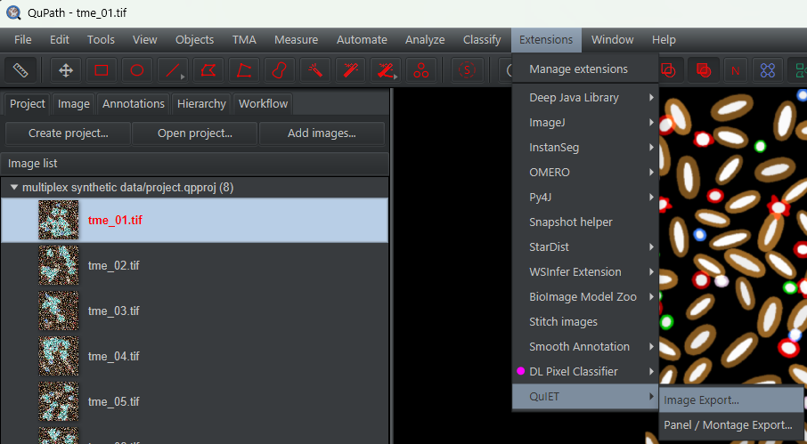
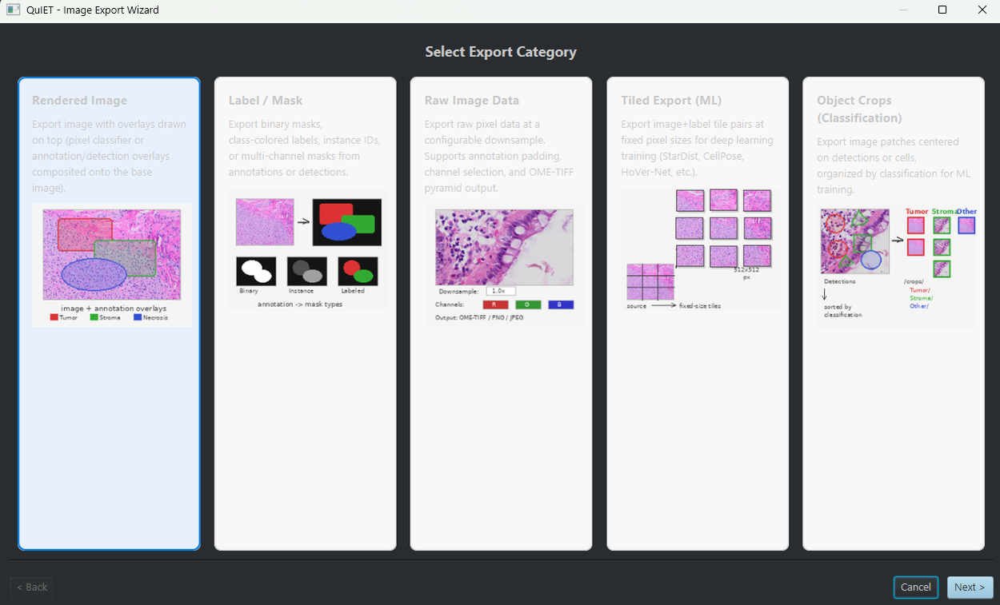
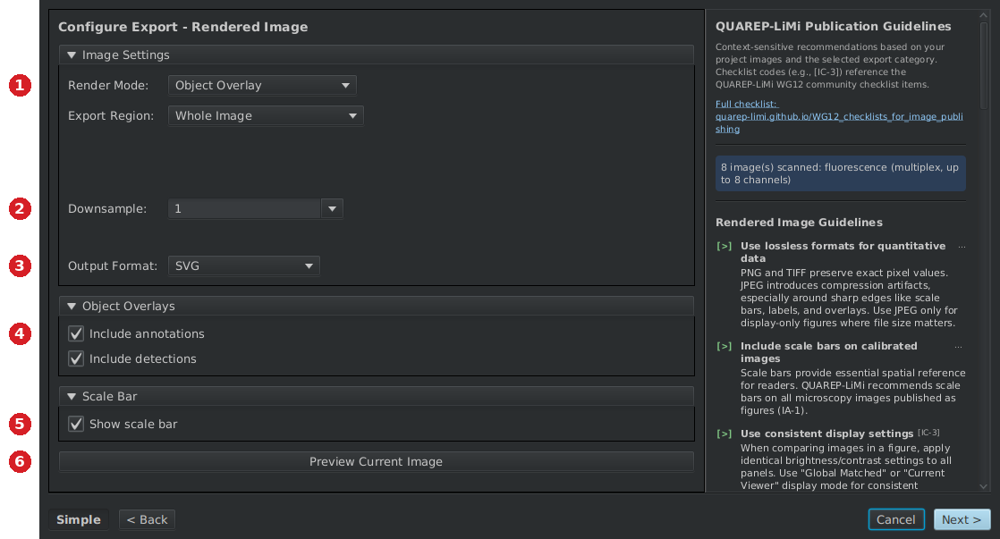
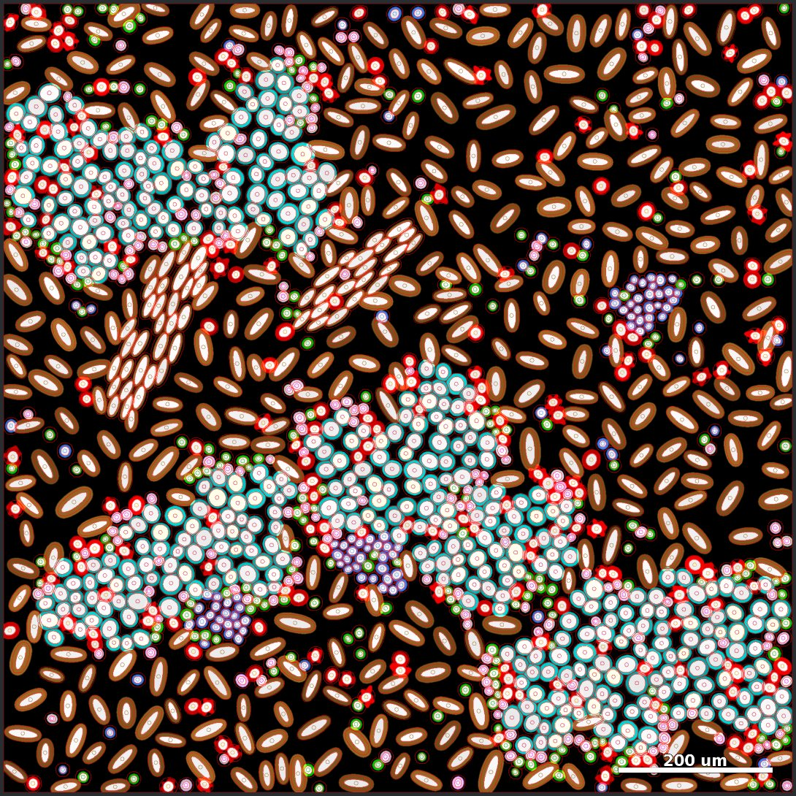
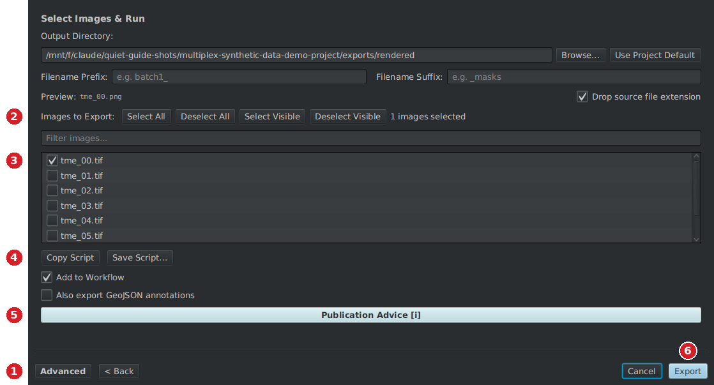
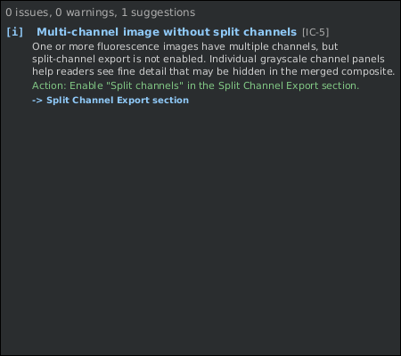
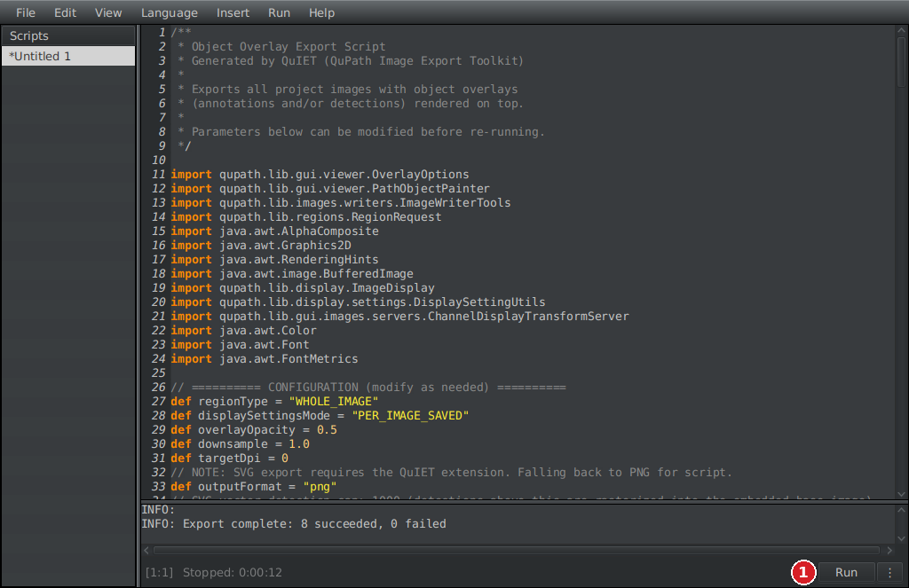
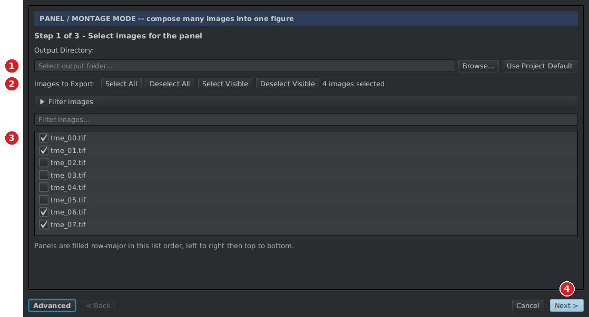
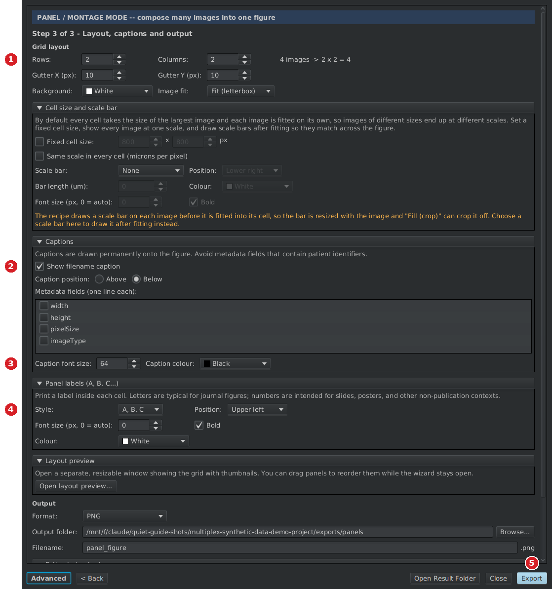
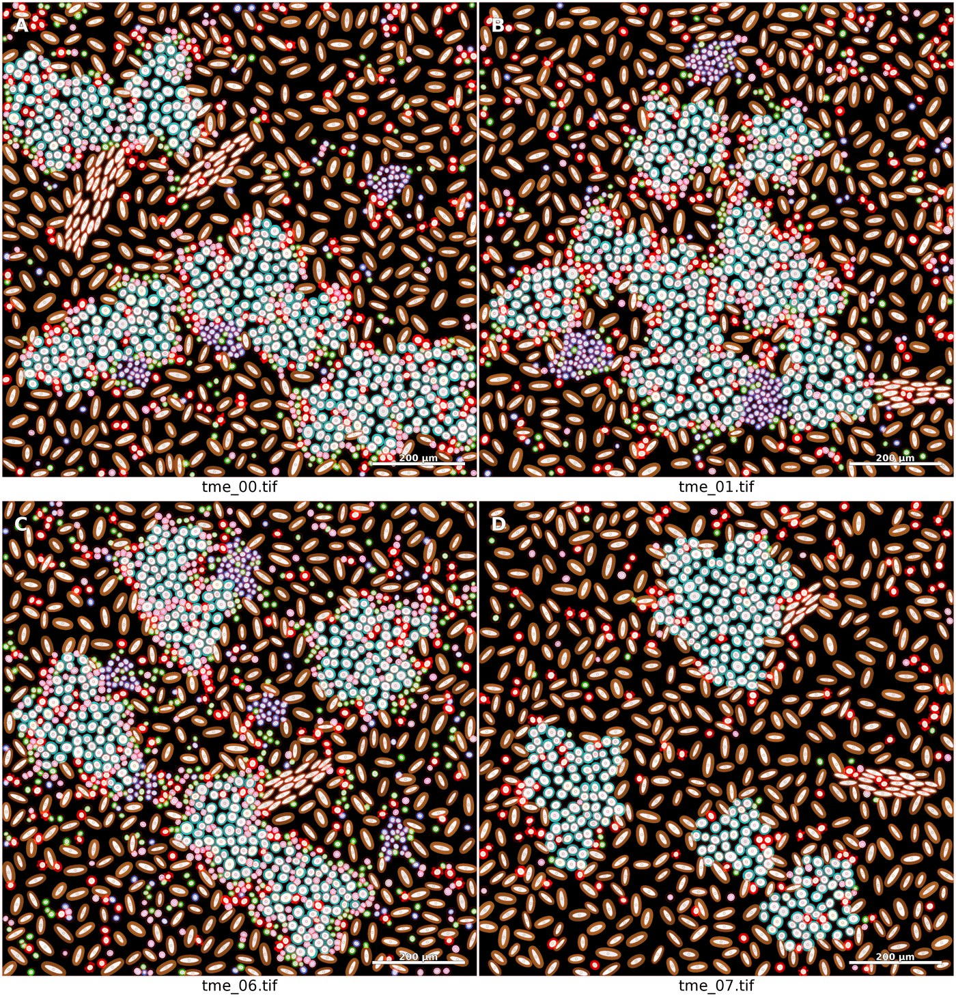

# QuIET — QuPath Image Export Toolkit

> Turn an annotated project into publication-ready figures, collaborator review images, or
> machine-learning training sets, in batch, without writing an export script. With
> QUAREP-LiMi reporting guidance built into the dialog.

| | |
|---|---|
| **Repository** | [uw-loci/qupath-extension-image-export-toolkit](https://github.com/uw-loci/qupath-extension-image-export-toolkit) |
| **Extension version** | 1.3.1 |
| **License** | Apache-2.0 |
| **Requires** | QuPath 0.7.0+, Java 21+ |
| **Where to find it** | `Extensions > QuIET > Image Export...` and `Extensions > QuIET > Panel / Montage Export...` |
| **Catalog** | LOCI QuPath Extensions |
| **Session** | Hands-on |

> **Walkthrough video:** %Video not ready yet%
> The walkthrough below is self-contained. You can work through it during the workshop, or on your own afterwards.

> **New to QuPath?** Words like *project*, *annotation*, *detection*, *class* and
> *measurement* are explained in the [glossary](glossary.md). For QuPath itself, the
> [official documentation](https://qupath.readthedocs.io/en/stable/) is the place to go.

**Steps:** [1. Get the data](#1-get-the-data) · [2. Load it into QuPath](#2-load-it-into-qupath) · [3. A figure you could publish](#3-a-figure-you-could-publish) · [4. The reproducibility half](#4-the-reproducibility-half) · [5. A multi-panel figure](#5-a-multi-panel-figure)
{: .toc}

---

## What it does

Exporting one image from QuPath takes a menu click. Exporting *the right image, the same way,
from forty slides, with a scale bar, at a stated resolution* normally means writing a Groovy
script. QuIET does that export without the script: a three-step wizard where you pick a
category, configure it, pick your images, and export.

**Five export categories**, all sharing the same 3-step flow:

| Category | Produces | Typical use |
|---|---|---|
| **Rendered** | The image as displayed, with overlays, scale bar, panel labels | Figures and collaborator review |
| **Label / Mask** | Per-class segmentation masks | ML training targets, QC |
| **Raw Image Data** | Pixel data at any downsample | Handing data to another tool |
| **Tiled Export (ML)** | Image + label tile pairs | Deep-learning frameworks |
| **Object Crops (Classification)** | One small image per object | Cell-type classifier training |

A sixth workflow, `Extensions > QuIET > Panel / Montage Export...`, is a separate menu item with
its own wizard:
select several project images, choose a *recipe* (saved settings for how a single image is
exported), and lay them out into one grid figure, with captions, spacing and background color.
QuIET renders every panel with the same settings, so you do not assemble the figure by hand
in another program.

## Two bonuses

**Every single-image export records a Groovy script.** Whatever you clicked in the wizard is
emitted as a self-contained script you can save, version-control, re-run next year, or send to
a collaborator who does not have QuIET installed. Save it from **Copy Script** or **Save
Script...** on the wizard's last screen (in **Advanced** mode). While **Add to Workflow** on that
screen is ticked (it is by default), the export is also recorded in
`Automate > Show workflow command history`.

Three exceptions:

- A Panel / Montage export (step 5) records only its settings. To make the figure again, run the
  export from the wizard.
- A classifier chosen as **(Active Overlay)** is the viewer's live classifier, not one saved in
  the project, so a script cannot load it.
- Unticking **Add to Workflow** leaves the export out of the workflow history; **Copy Script**
  and **Save Script...** still work.

**QUAREP-LiMi guidance is in the dialog.** [QUAREP-LiMi](https://quarep.org/) is the
community effort to define minimum reporting standards for light microscopy. The settings screen
shows a guidance panel driven by your project's actual images, and the last screen has
**Publication Advice** for the images you selected, before you export. It flags problems such
as a missing scale bar or a missing pixel size before the figure goes into a manuscript. The
checklist codes it shows (`IC-5`, `IA-1` ...) are the item numbers of the QUAREP-LiMi image
publishing checklists ([Schmied et al., *Nature Methods*, 2024](https://doi.org/10.1038/s41592-023-01987-9)).

> **Simple vs Advanced.** The navigation bar has a Simple/Advanced toggle; Simple is the
> default and hides rarely-used controls. If a setting described here seems to be missing,
> flip to Advanced. The choice persists across sessions.

<details markdown="1">
<summary><b>Install</b> — from the LOCI catalog, then restart QuPath</summary>

Install from the **LOCI QuPath Extensions** catalog, then restart QuPath. Full steps, including the catalog URL, are in the [setup guide](setup.md).

Both menu items stay grayed out until a project with at least one image is open.

</details>

---

## Hands-on exercise

### 1. Get the data

**Download:** `multiplex-synthetic-data-demo-project-v1.2.zip` —
**[direct download](https://github.com/uw-loci/multiplex-synthetic-data/releases/download/v1.2/multiplex-synthetic-data-demo-project-v1.2.zip)**
(20 MB). The same project used by Classify Object Subset and Class Distribution, so if you
already have it, you are done here. It is a ready-made QuPath project of eight synthetic
8-channel multiplexed images, `tme_00.tif` … `tme_07.tif`, from the CC0
[multiplex synthetic dataset](https://github.com/uw-loci/multiplex-synthetic-data/tree/v1.2). Cells are
already detected on every image, and every cell carries a classified ground-truth point, so
there are objects to draw in step 3 and a known answer to check mask and tile exports against.

**You will also need:** QuPath **0.7.0 or later**, and this extension installed from the LOCI
catalog (see the **Install** box above, or the [setup guide](setup.md)).

> **Steps 3 and 4 need one image. Step 5 needs at least two**, because it builds a figure out
> of several panels. This project gives you eight.

> **Already have the 14 MB `multiplex-synthetic-data-v1.2.zip` from Track B?** Those are the
> same eight images as loose files, with the ground truth beside them as CSV and GeoJSON, but
> with no project and no cells detected. The 14 MB zip works for this exercise once you have added the
> images to a project and run cell detection — the recipe is in the
> [QP-CAT guide](03-qp-cat-cell-analysis-tools.md#hands-on-exercise). The demo project above
> skips both steps.

### 2. Load it into QuPath

1. **Drag `project.qpproj` onto an open QuPath window.** The unzipped folder itself works too.
   (Menu route: `File > Project > Open project...`.) QuPath opens an **Update URIs** dialog with
   the images listed in red. This is expected: QuPath cannot find the images until you show it
   the folder once.
2. **Click Search...** (bottom-right) and choose the folder you unzipped.
3. **Click Apply changes.**
4. **Double-click `tme_00.tif`** to open it. You should see cell outlines (the detections) and a
   colored dot on each cell (the ground-truth points). Those are the objects step 3 draws
   onto the figure, so there is nothing to annotate by hand.

### 3. A figure you could publish

#### 3.1 Open the wizard and pick a category

1. **Open `Extensions > QuIET > Image Export...`.** The second entry in the same menu,
   `Extensions > QuIET > Panel / Montage Export...`, is used in step 5.

   
2. **Click Rendered Image**, the leftmost of the five categories.

   
3. **Click Next >.**

#### 3.2 Configure the export

The numbers match the badges in the picture below the table.

| # | Setting | Set to |
|---|---|---|
| 1 | **Render Mode** | **Object Overlay**. It starts on **None (no overlay source)**, which exports a clean image with no objects drawn |
| 2 | **Downsample** | **1** |
| 3 | **Output Format** | Leave it. It reads **PNG** until you tick row 4, then changes to **SVG** by itself. If it shows another format, choose **SVG** |
| 4 | **Include annotations** | Ticked. The ground-truth points are annotations, and this box starts unticked. **Include detections**, the cell outlines, is already ticked |
| 5 | **Show scale bar** | Ticked |
| 6 | **Preview Current Image** | Click it to check the result before exporting |



SVG keeps the scale bar and the ground-truth points as sharp vector shapes; the collapsed box
below explains what happens to the cell outlines. The **Object Overlays** and **Scale Bar**
sections may be collapsed when you arrive. **Click a section's title** to open it.

**Click Preview Current Image.** A window opens with the image as it will be exported: cell
outlines, a colored dot on each cell, and a `200 µm` scale bar in the lower right. The window
stays up to date: change a setting in the wizard and the preview redraws within a second or
so, as the line under the image says.



**Close the preview window**, then **click Next >**.

<details markdown="1">
<summary>What Downsample and the guidelines panel are for</summary>

**Downsample** shrinks the exported image: **1** means full size, **4** means a quarter as
wide. These images are 2048 × 2048 pixels, so full size is fine. On a whole-slide image tens
of thousands of pixels wide, check the width in QuPath's **Image** tab (the wizard does not
block the main window, so you can do it with the wizard open) and divide by roughly 2000 to
get the number to enter.

The panel down the right is general QUAREP-LiMi guidance for the kind of export you picked,
plus one line saying how many of your images it scanned and what type they are. Advice about
the images you select comes at the next screen, under **Publication Advice**.

SVG keeps annotations and the scale bar as vector shapes, but keeps detections as vectors only
up to 1000 of them. These images have about 1500 cells each, so QuIET draws the cell outlines
into the picture itself; the ground-truth points (annotations) and the scale bar stay vector.

The exported pixel size is the image's pixel size times the downsample: these images are
0.5 µm per pixel, so downsample 4 would give 2 µm per pixel. `export_info.txt` records it.

</details>

#### 3.3 Choose one image and read the advice

The wizard opens in **Simple** mode the first time. **Copy Script** and **Save Script...**,
which step 4 needs, only show in **Advanced** mode.

| # | Control | Do this |
|---|---|---|
| 1 | **Simple** / **Advanced** toggle | If it reads **Simple**, click it so it reads **Advanced** |
| 2 | **Deselect All** | Click it. Every image in the project starts ticked |
| 3 | `tme_00.tif` | Tick it, and only it. The count beside **Deselect All** reads `1 images selected` |
| 4 | **Copy Script** / **Save Script...** | Leave for step 4 |
| 5 | **Publication Advice [i]** | Click it |
| 6 | **Export** | Click it when you have read the advice |



**Output Directory** is already filled in: an `exports/rendered` folder inside the project
folder. Leave it.

**Click Publication Advice [i].** A window lists what QuIET found in the images you
selected, each item tagged with its QUAREP-LiMi checklist code. With the settings above and
one image ticked you get one suggestion and no warnings. Had **Show scale bar** been off, the
list would also hold an item about the missing scale bar. With a second image ticked, a
suggestion about per-image display settings (`IC-3`) joins it, because the advice follows your
selection.



**Close the advice window**, then **click Export.** In a few seconds the bottom of the wizard
reads `Exported 1 images.`, the result folder opens in your file browser, and **Open Result
Folder** and **Close** appear beside **Export**. Leave the wizard open for step 4.

#### 3.4 Check the result

**Look in the folder that opened** (or click **Open Result Folder** if none did). It holds two
files:

```
export_info.txt
tme_00.svg
```

**Open `tme_00.svg`** in a web browser. It matches the preview. Check that the scale bar is
legible at the size you would print it.

**Open `export_info.txt`.** It names the QuIET and QuPath versions, then lists the export
category, the downsample, every channel's name and color, and the pixel size
(`Pixel Size: 0.5 um/px (downsample 1x from 0.5 um/px)`), ready for a figure legend. It does not
hold the brightness and contrast used: with the default display settings it says
`Per-image (varies -- see QuPath project)`.

### 4. The reproducibility half

#### 4.1 Copy the script

**Click Copy Script** (badge 4 in the step 3.3 picture). The Groovy script for the export you just ran is now on
the clipboard. **Save Script...** writes the same script to a file instead.

**Click Close** to close the wizard.

#### 4.2 Run it from the script editor

1. **Open `Automate > Script editor`.**
2. **Paste the script with Ctrl+V** (Cmd+V on a Mac).
3. **Click Run** (badge 1, bottom right).



The output pane at the bottom lists each image as it goes, then
`Export complete: 8 succeeded, 0 failed`.

#### 4.3 Compare

**Open the `exports/rendered` folder again.** Beside `tme_00.svg` there are now eight PNGs,
`tme_00.png` to `tme_07.png`, all rendered with the settings you chose in step 3.

The script differs from the wizard in three ways; the first two are written at the top of the
script:

- **It runs on every image in the project**, not only the ones you ticked.
- **It writes PNG, not SVG.** SVG export needs QuIET installed; the script runs on any
  QuPath 0.7 without it, so you can send it to a collaborator.
- **It reads each image's saved brightness and contrast when it runs.** If you change an
  image's display and save it, a re-run uses the new settings. To pin them, choose
  **Global Matched** or **Current Viewer Settings** under **Display Settings** (Advanced mode)
  before copying the script.

The **CONFIGURATION** block at the top holds every setting as a line you can edit, for
example `def downsample = 1.0`, before running it again.

### 5. A multi-panel figure

#### 5.1 Pick the images

1. **Open `Extensions > QuIET > Panel / Montage Export...`.** A message titled **Build one
   figure from many images** explains recipes.
2. **Click OK.**

| # | Control | Do this |
|---|---|---|
| 1 | **Use Project Default** | Click it. **Output Directory** starts empty |
| 2 | **Deselect All** | Click it |
| 3 | Image list | Tick `tme_00.tif`, `tme_01.tif`, `tme_06.tif` and `tme_07.tif`. `tme_06` is immune-rich and `tme_07` immune-poor, the two most different images in the set |
| 4 | **Next >** | Click it |



Panels are filled in list order, left to right and then top to bottom, so this order gives
`tme_00` and `tme_01` on the top row.

#### 5.2 Accept the recipe

The **recipe** is the set of settings applied to every panel. It starts from your most recent
Image Export, so it already has **Object Overlay**, **Downsample** 1 and the scale bar from
step 3.

**Click Next >.**

#### 5.3 Layout, captions and panel letters

| # | Setting | Set to |
|---|---|---|
| 1 | **Rows** / **Columns** | Leave at **2** and **2**. The line beside them reads `4 images -> 2 x 2 = 4` |
| 2 | **Show filename caption** (under **Captions**) | Ticked |
| 3 | **Caption font size** | **64**. At the default 14 the captions are too small to read on a figure 4126 pixels wide |
| 4 | **Style** (under **Panel labels (A, B, C...)**) | **A, B, C** |
| 5 | **Export** | Click it |



**Captions** and **Panel labels (A, B, C...)** are collapsed sections further down the
screen. **Scroll down and click each title** to open it.

**Open layout preview...** shows the grid as thumbnails in a separate window, where you can
drag one panel onto another to swap them.

#### 5.4 Open the figure

**Look in the folder that opened** (or click **Open Result Folder**). `exports/panels` holds
`panel_figure.png` and `panel_figure_info.txt`, which lists the QuIET version, the layout, the
recipe and the four source images in order.

**Open `panel_figure.png`.** It looks like this: four panels drawn with the same recipe,
lettered A to D, each with its own scale bar and its filename underneath.



### What to notice

- Every panel in the montage got the same recipe: the same downsample, overlays and scale bar.
  Brightness and contrast are each image's own saved settings unless **Display Settings** is
  **Global Matched** (Advanced mode); use Global Matched for a figure where readers compare
  brightness between panels.
- Publication Advice never blocks an export. It lists what a reviewer may ask about.
- **Label / Mask** (the second category on the wizard's first screen) exports masks from the
  same annotations, for training a model, with no extra annotation work. Try it if you have
  time.

---

## Going further

- Object Crops writes one small image per object, in a folder per class, ready for training a
  cell-type classifier.
- Tiled export writes image and label-mask tile pairs at a fixed tile size, for training a
  model outside QuPath (StarDist, Cellpose and similar tools). The
  [DL Pixel Classifier](02-dl-pixel-classifier.md) does not need it: it trains directly from
  the annotations in your QuPath project.
- **Maps on one color scale.** Render Mode **Density / Map Overlay** colors a map over each
  image. In the **Overlay Source** section, **Map Source** chooses a density map saved in the
  project (made with `Analyze > Density maps > Create density map...`) or a map file per image
  written by another program, such as a probability map. The default **Color Range**, **Each
  image: its own min to max**, stretches every image to its own range, so the same color means
  different values in different images. Choose **Shared: percentiles of all exported images**
  or **Fixed: the same values for every image** to put every image on one scale, and set
  **Overlay Opacity** to 1 so the colors match the color scale bar. The range used is written
  to `export_info.txt`. The
  [repository README](https://github.com/uw-loci/qupath-extension-image-export-toolkit#readme) explains
  the details, including how to find each image's map file.

**Full documentation:** the
[repository README](https://github.com/uw-loci/qupath-extension-image-export-toolkit#readme).
